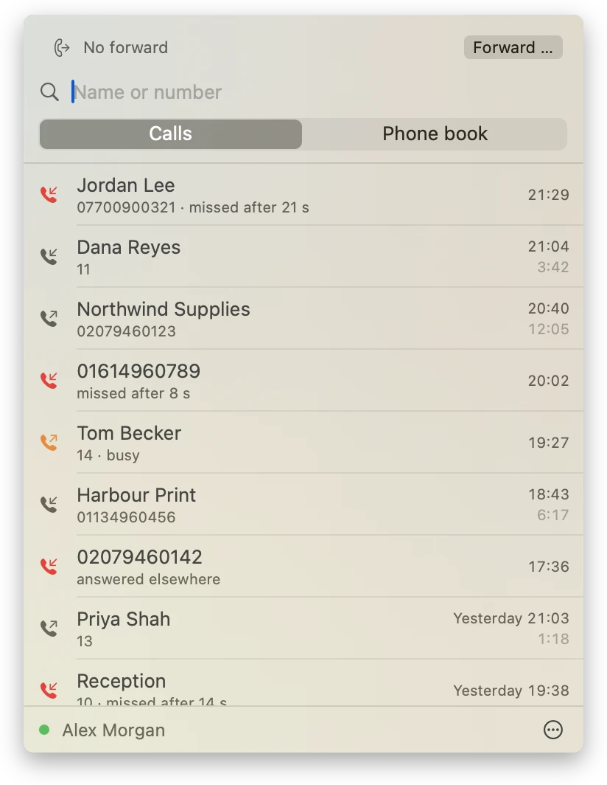
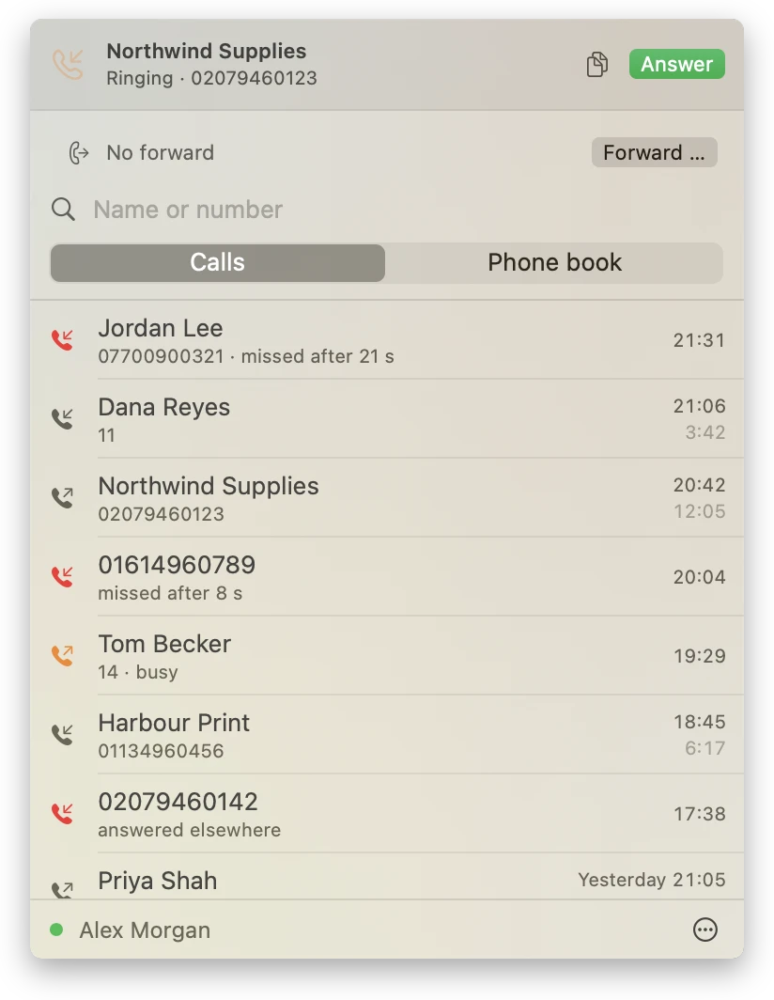
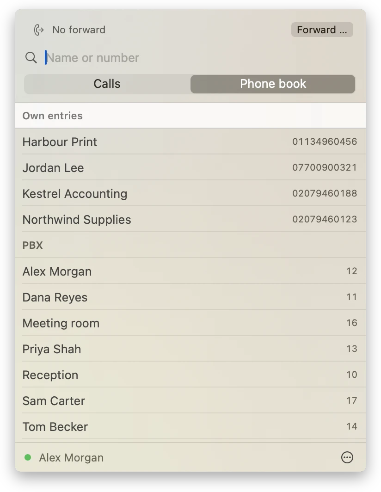
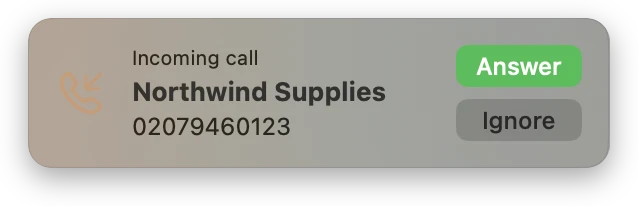

# Fernsprecher

A macOS menu bar app for the Alcatel-Lucent OXO Connect telephone system (PBX). It shows what happens on your extension and lets you act on it without picking up the desk phone:

- Call log with call back
- Phone book search and dialling
- Missed call count on the menu bar icon
- Live display of ongoing calls with answer/hang up
- Optional incoming call popup
- Show, set and cancel call forwarding

<p align="center">
  
  
  
</p>

<p align="center">
  
</p>

*Fernsprecher* is the old-fashioned German word for telephone – literally "far speaker" – the term the Deutsche Bundespost used on phone booths and in phone books.

The app talks to the OXO's XML Web Services interface (SOAP over HTTPS/443), the same one PIMphony uses. It was developed and tested against a single OXO Connect R63; other releases are untested. Two assumptions come from that installation: extensions have at most 4 digits, so longer numbers count as external, and the app reads at most 500 entries of the PBX directory.

> Fernsprecher is an unofficial, private project and is not affiliated with, endorsed or reviewed by Alcatel-Lucent Enterprise (ALE). Alcatel-Lucent, OmniPCX Office (OXO) and PIMphony are trademarks of their respective owners and are mentioned only to describe which products the app works with.

## Installation

Requires macOS 14 or later (Apple Silicon or Intel).

1. Download `Fernsprecher-<version>.zip` from the [releases page](https://github.com/mgeha/fernsprecher/releases) and unpack it.
2. Move `Fernsprecher.app` to the Applications folder and open it.
3. macOS blocks the first launch. Open System Settings → Privacy & Security, scroll down to the message about Fernsprecher and click "Open Anyway". This is needed once per downloaded version. Alternatively, remove the quarantine attribute before the first launch:

   ```sh
   xattr -dr com.apple.quarantine /Applications/Fernsprecher.app
   ```

4. Allow access to the local network when macOS asks, then set up the PBX (see [Usage](#usage)).

macOS blocks the app because there is no Apple Developer account behind it: it is signed ad hoc and not notarised. A copy you [build yourself](#building) starts without the warning.

To check the download against the checksum published with the release:

```sh
shasum -a 256 -c Fernsprecher-<version>.zip.sha256
```

## Usage

### Setup

Menu bar → "Set up …": enter PBX, port, extension and PIN. The settings are stored in the user defaults. The PIN is stored in `~/Library/Application Support/Fernsprecher/pins.json`, a file only the user can read, instead of the keychain: without a Developer ID, macOS would keep asking for the keychain password.

### Connection

- **One session per extension:** The OXO allows only one session per extension. If PIMphony or `oxoctl` logs in on the same extension, Fernsprecher shows "Session lost" and does not take the extension back on its own. "Reconnect" in the menu logs in again (ending the other session).
- **Warnings:** Without a connection, the menu bar shows the hung-up receiver with "!". A notification appears when the session is lost, when extension or PIN are rejected, and when the PBX has been unreachable for 5 minutes. It disappears once the connection is back. After sleep, the app reconnects on its own.

### Calls

- **Ongoing calls:** A ringing or ongoing call appears at the top of the menu right away, with "Answer" or "Hang up". A green dot at the bottom of the menu means live, a yellow one polling only.
- **Call popup:** While a call is ringing, a small window appears at the top right with name/number, "Answer" and "Ignore". It does not take focus and disappears by itself. Can be turned off in the settings.
- **Missed calls:** The count is shown on the menu bar icon. Opening the menu marks the missed calls in the list as seen, as in PIMphony; the counter on the phone goes down as well. Older missed calls are marked once "Load older" brings them into the list.

### Dialling and numbers

- **Dialling:** Double-click or the receiver icon in the call log or phone book, or type a name/number into the search field and press Enter. The extension's phone then dials. From the call log and phone book, the app adds the trunk prefix for external numbers itself (settings, default `0`). Typed numbers are dialled as entered, like on a desk phone, so external ones need the trunk prefix.
- **Copy number:** Right-click an entry in the call log or phone book; during a call, also the copy icon next to "Hang up". The number is copied without the trunk prefix.
- **Own names:** Right-click a number in the call log and choose "Save name …" to give it a name. These names appear under "Own entries" in the phone book and are stored in `~/Library/Application Support/Fernsprecher/addressbook.json`. When editing the file by hand, leave out the trunk prefix.

### Forwarding

Above the search field, the app always shows whether forwarding is active, even if it was set on the phone or in PIMphony ("Forwarded to 11 · Reception", "On no answer to voicemail"). When forwarding is active, the bar is highlighted and the receiver in the menu bar carries an arrow. Forwarding on no answer set in PIMphony only shows up when the menu is opened or after 30 s at most.

- "Forward …" forwards all calls immediately. The number is sent as typed, so external numbers need the trunk prefix; a hint below the input field reminds you. The last number used is prefilled.
- "Off" cancels forwarding, including forwarding on no answer.
- The bottom of the menu then shows whether it worked. If the PBX rejects a target, "The PBX did not accept the forward to …" appears.

### PBX certificate

Selectable in the settings, applies only to the configured PBX:

- **Remember fingerprint** (default): On the first connection, the app remembers the certificate's SHA-256 fingerprint and from then on connects only with exactly this certificate. This suits the OXO's self-signed certificate.
- **System check:** regular validation by macOS, e.g. for a certificate from a company CA.
- **Accept any:** no check, and so no protection against eavesdropping.

If the PBX presents a different certificate, or macOS rejects it, the app does not connect and does not keep retrying. It reports "PBX certificate rejected". The settings then show the remembered and the presented fingerprint along with "Trust this certificate". If PBX or port change, the app forgets the remembered fingerprint.

### Language

German and English. By default, the app uses the first language it knows from the list in System Settings → General → Language & Region; if it knows none of them, English. Under "Language" in the settings it can be fixed to German or English. This takes effect on the next launch; "Restart now" logs the app out and restarts it. The choice is stored as the app's `AppleLanguages`, the same key macOS uses for per-app languages.

## Diagnostics

If the live display (yellow dot) or the connection fails, the reasons are in the system log (subsystem `de.1lov.fernsprecher`, category `events` for the event stream, `session` for login, state and retries):

```sh
log show --last 1d --info --predicate 'subsystem == "de.1lov.fernsprecher"'
log stream --info --predicate 'subsystem == "de.1lov.fernsprecher"'   # follow live
```

Example: `stream failed: url -1001 (attempt 3, live=true, 12 events, after 148 s, retry in 20 s)`. This shows the kind of error (e.g. `url -1001` = timeout, `status subscribe 4 UnknownUser`, `soapFault`), the attempt, the runtime and the next interval. `live=false` means the stream never got as far as subscribing to events. `session` contains entries such as `state: sessionLost`, `session lost (no live events): not renewed` or `retry in 60 s`.

Error kinds, codes, the PBX's status labels, counters and durations are logged readably. Error messages, which can contain numbers, names or the PBX address, are logged as `<private>`.

## Development

The protocol code lives in `OxoKit`, the app in `Sources/Fernsprecher`. How the app talks to the PBX (calls, polling intervals, retries, R63 quirks) is described in [`docs/protocol.md`](docs/protocol.md).

### Building

Building needs Swift 6.0 or later. The Command Line Tools are enough, Xcode is not needed:

```sh
sh scripts/test.sh          # unit tests (Swift Testing)
sh scripts/build-app.sh     # Fernsprecher.app (universal, ad-hoc signed)
sh scripts/build-release.sh # Fernsprecher-<version>.zip and its checksum for a release
swift scripts/make-icon.swift   # only after design changes: redraw Resources/Fernsprecher.icns
```

The app ends up in `build/`, SwiftPM intermediates in `.build/` as with `swift build` (both in `.gitignore`).

Two quirks of the Command Line Tools are handled:

- `scripts/test.sh` passes the plugin path for Swift Testing (`plugins/testing/`), which SwiftPM does not find otherwise.
- In the macOS 27 SDK, `@State` is a macro whose plugin only ships with Xcode. The views therefore use `@ViewState` (a type alias for the classic property wrapper, `Sources/Fernsprecher/ViewState.swift`).

### Demo mode

No OXO at hand? A debug build can run against a built-in fake PBX with invented data. It uses settings and files of its own and is not part of release builds.

```sh
sh scripts/demo.sh        # call log, phone book, forwarding, dialling
sh scripts/demo.sh call   # also rings an incoming call after a few seconds
```

### Developer CLI

`oxoctl` tries out individual calls against a real PBX:

```sh
swift run oxoctl 192.168.1.10 version
swift run oxoctl 192.168.1.10 --line 10 --password-file ~/.oxoctl-pin calllog 20
swift run oxoctl 192.168.1.10 --line 10 --password-file ~/.oxoctl-pin missed
swift run oxoctl 192.168.1.10 --line 10 --password-file ~/.oxoctl-pin phonebook Meier
swift run oxoctl 192.168.1.10 --line 10 --password-file ~/.oxoctl-pin call 11
swift run oxoctl 192.168.1.10 --line 10 --password-file ~/.oxoctl-pin userstate
swift run oxoctl 192.168.1.10 --line 10 --password-file ~/.oxoctl-pin forward 11   # or: forward off
swift run oxoctl 192.168.1.10 --line 10 --password-file ~/.oxoctl-pin monitor --raw events.xml
```

- **Certificate:** `oxoctl` checks the certificate the way macOS does. For the OXO's self-signed certificate, pass its fingerprint with `--fingerprint <sha256>`. `--insecure` accepts any certificate and prints its fingerprint. If `oxoctl` rejects a certificate, the error message shows the fingerprint.
- **`userstate`** is read-only (`getOXOUserState`).
- **`forward`** sets or cancels forwarding and prints the state before and after as well as the PBX's events.
- **`shell`** keeps a session open, reads commands from stdin and prints all events, for trying out features the app does not use yet (`dnd on`, `noanswer vm 20`, `callop holdCall HoldCallInvoke <callRef>`; the list is in the header of `Sources/oxoctl/main.swift`). With `tail -f commands.txt | swift run oxoctl … shell` you can drive several extensions in parallel.
- **`monitor`** prints the live events. With `--raw` it also writes the envelopes to a file, with the session ID redacted.

Every `oxoctl` login ends the app's session on the same extension.

## Contributing

Bug reports and pull requests are welcome.

- For a bug, please include the OXO release and the log lines from [Diagnostics](#diagnostics).
- Do not post raw captures: `oxoctl monitor --raw` redacts the session ID, but not phone numbers and names.
- Run `sh scripts/test.sh` before opening a pull request.

## License

MIT, see [LICENSE](LICENSE).
